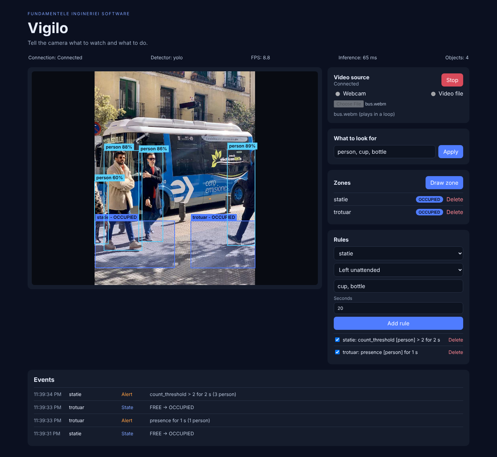

# Vigilo

A camera you tell in words what to watch and what to do.

Type the objects to look for ("person", "cup", "bottle"), draw named zones on
the video ("masa 1", "masa 2") and add rules such as "objects left on masa 1
with nobody there for 20 seconds: needs clearing". Detection is
open-vocabulary (YOLO-World): any word works, without training.

Built for cafes (free tables, tables to clear, queue at the bar) and small
shops (empty shelf, queue at the till). Team project for Fundamentele
Ingineriei Software, FMI UniBuc.

Stack: React 18 + Vite, FastAPI, Ultralytics (YOLO-World, YOLO11n fallback),
binary WebSockets, SQLite. Pure software: it runs on any laptop with a webcam,
no extra hardware.



*Real run of this repository with the `yolo` detector on a looping video of
the Ultralytics sample image `bus.jpg`. The zone "statie" was drawn with the
mouse; its `count_threshold` rule (more than 2 people for 2 s) fired with 3
people inside.*

Working on the code with the team: see [CONTRIBUTING.md](CONTRIBUTING.md)
(git branches and pull requests, in Romanian).

## How it works

```
Browser (React)                          Backend (FastAPI, Python 3.10)
<video> live (webcam or file)
  -> hidden canvas -> JPEG  == WS binary ==> /ws/detect
                                              -> Detector (openvocab | yolo | fake)
                                              -> zones.assign (which detections fall in which zone)
                                              -> RuleEngine (zone states + timers)
                                              -> EventBus -> SQLite
<canvas> overlay: boxes, zones, states  <== WS JSON ==
```

- The browser draws the overlay, so the video stays fluid even when detection
  runs at a few frames per second ([ADR-002](docs/ADR-002-zones-rules-client-overlay.md)).
- Each zone is FREE, OCCUPIED or NEEDS_CLEARING. Rule types: `presence`,
  `left_unattended`, `count_threshold`, with a 0.5 s debounce.
- Only events are stored (zone state changes, rules triggered and cleared). No
  frame is ever written to disk and the server never sends images back.

## Requirements

- Docker with Docker Compose (Docker Desktop on Windows and macOS, Docker
  Engine on Linux), or Python 3.10 to 3.12 and Node.js 20 or newer.
- `git`, to clone the repository and to install the `clip` package.
- A webcam, or a video file. The browser asks for camera access, which works
  only on `localhost` or HTTPS.

## Get the code

```bash
git clone https://github.com/WEX75/Real-Time-Object-Detection.git
cd Real-Time-Object-Detection
```

## Run with Docker

The same command on Windows (PowerShell), Linux and macOS:

```bash
docker compose up --build
```

On Linux, if Docker says permission denied, run it with `sudo` or add your
user to the `docker` group (`sudo usermod -aG docker $USER`, then log out and
back in).

Open <http://localhost:5173>. The backend is at <http://localhost:8000/api/health>.

The first start downloads the YOLO-World weights and the CLIP text model; a
named volume caches them across rebuilds. Set `VIGILO_DETECTOR=yolo` in
`docker-compose.yml` to use the smaller COCO-only model.

## Run without Docker

Two terminals: one for the backend, one for the frontend. The backend runs on
<http://localhost:8000>, the frontend on <http://localhost:5173>.

### Linux and macOS

Backend:

```bash
cd backend
python3 -m venv .venv            # use python3.10, python3.11 or python3.12 if python3 is newer
source .venv/bin/activate
python -m pip install --upgrade pip
# Linux: CPU-only PyTorch (smaller download). On macOS skip this line.
python -m pip install torch torchvision --index-url https://download.pytorch.org/whl/cpu
python -m pip install -r requirements.txt
python -m uvicorn app.main:app
```

Frontend:

```bash
cd frontend
npm install
npm run dev
```

On Ubuntu or Debian, install the prerequisites first:

```bash
sudo apt update
sudo apt install -y git python3-venv nodejs npm libgl1 libglib2.0-0
```

If `node --version` prints a version older than 20, install Node.js 20 from
<https://nodejs.org> instead. On macOS: `brew install python@3.12 node git`.

### Windows (PowerShell)

Backend:

```powershell
cd backend
py -3.10 -m venv .venv
.\.venv\Scripts\Activate.ps1
python -m pip install --upgrade pip
python -m pip install torch torchvision --index-url https://download.pytorch.org/whl/cpu
python -m pip install -r requirements.txt
python -m uvicorn app.main:app
```

Frontend:

```powershell
cd frontend
npm install
npm run dev
```

Open <http://localhost:5173>. If PowerShell blocks activation, run
`Set-ExecutionPolicy -Scope Process -ExecutionPolicy Bypass` and activate again.
Installing `requirements.txt` needs `git` on the PATH (the `clip` package comes
from GitHub).

## Using it

1. **Start** with the webcam, or pick a video file (it plays in a loop).
2. Enter the words to look for, comma separated, and **Apply**.
3. **Draw zone**: click points on the video, double-click to close, name it.
4. Add a rule, for example `left_unattended` on "masa 1", labels `cup, bottle`,
   20 seconds.
5. Zones change colour on the video (green FREE, blue OCCUPIED, orange
   NEEDS_CLEARING) and every change appears in the event log.

Objects the size of a cup or larger detect well; small objects far from the
camera do not.

## Configuration

| Variable | Default | Meaning |
| --- | --- | --- |
| `VIGILO_DETECTOR` | `openvocab` | `openvocab` (YOLO-World) or `yolo` (YOLO11n, COCO classes). If openvocab fails to load, the backend falls back to yolo. |
| `VIGILO_CONF` | `0.25` | Minimum detection confidence. |
| `DATABASE_PATH` | `events.sqlite3` | SQLite file for zones, rules, vocabulary and events. |

## Performance

Measured on the development laptop (CPU only, 640 px input):

| Detector | Inference per frame | Effective rate |
| --- | --- | --- |
| openvocab (`yolov8s-worldv2.pt`) | 230-500 ms | about 2-4 FPS |
| yolo (`yolo11n.pt`) | 100-160 ms | about 6-9 FPS |

The client sends the next frame only after the reply to the current one, at
most 10 FPS, so a slow detector never builds a queue. The live video stays at
the camera frame rate.

## Tests

With the backend virtual environment active (any OS):

```bash
cd backend
python -m pytest -m "not model" -v     # what CI runs, no model download
python -m pytest -m model -s           # loads the real detectors and prints timings
cd ../frontend
npm run build
```

## Repository structure

- `backend/app/`: `main.py` (app factory, REST, WebSocket), `detector.py`
  (Strategy), `zones.py` (point in polygon), `rules.py` (State machine),
  `events.py` (Observer), `database.py` (Repository), `clock.py`, `schemas.py`.
- `backend/tests/`: zones, rules, schemas, database, events, detector, API,
  WebSocket and privacy tests.
- `frontend/src/`: React dashboard; `VisionViewport.jsx` draws the overlay and
  the zones.
- `.github/workflows/ci.yml`: backend tests and frontend production build.
- `docs/`: architecture decision records.
